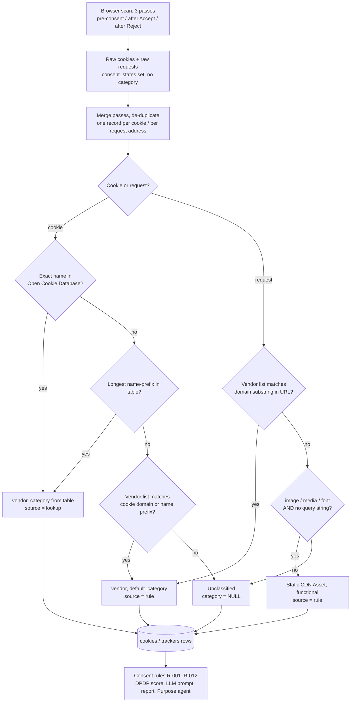

# Purpose Classifier — what it is, what it does, what it does not do

**Status of this document:** an audit of the code as it stands on 2026-10-23. Nothing was changed to write it. Every statement is either
tied to a file and line, or shown by a small run of the real functions (marked **[run]**), or by a read-only query of the live reference data
(marked **[db]**). Where something could not be confirmed it says so (section 15).

A word on the name. The code has **no single module called "Purpose Classifier"**. The behaviour the Consent Agent calls by that name is the
step that gives each cookie and each third-party request one of four **purpose categories** (`analytics`, `marketing`, `functional`, `other`),
plus a vendor name. It is spread over a few small modules, listed in section 2. Two *other* components in the repository also deal with
"purpose" and are easy to confuse with it; section 2.2 says what they are and that they are separate.

---

## 1. Executive summary

- **It is deterministic. No AI model and no machine learning decides a purpose.** Every classification comes from (a) a table of cookie names
  (the Open Cookie Database, 2,266 rows), or (b) a hand-written list of vendor signatures (48 vendors) matched against domains, script URLs and
  cookie-name prefixes, or (c) one narrow heuristic that labels plain image, media and font requests as "Static CDN Asset / functional".
  Tests pin that the language model cannot change a classification (section 8).
- **It labels what a thing *is*, not what it *does*.** It looks at the cookie's name and the request's address. It never reads script contents,
  never watches behaviour, never sees whether personal data was sent, and never checks whether a tracker honoured Accept or Reject.
- **Anything it does not recognise stays unclassified** (`category = NULL`). It is not defaulted into `other`. Unclassified items are reported
  for a human to review (rule R-008) and are **invisible to the main "tracking before consent" rule (R-001)**, which only counts `analytics`
  and `marketing`.
- **There is no confidence score on a classification.** What is stored is a provenance label: `source` = `lookup` or `rule`. The `high`/`low`
  confidence in the code belongs to *findings*, not to categories.
- **Results are stored on the evidence rows** (`cookies`, `trackers`, `third_party_services`) and consumed by the consent rules, the DPDP score,
  the LLM prompt, the report and the Purpose agent. A purpose label alone is never a legal conclusion: a finding needs the label *plus* the
  consent state in which the item was seen.
- **A correction path exists in code but is not wired to anything a user can reach** (section 3.9).
- **Measured facts worth knowing up front (details in sections 4 and 12):** a cookie-name prefix such as `IDE` matches any cookie starting with
  those letters (`IDENTITY`, `IDEA` are labelled Google Ads / marketing) **[run]**; the cookie lookup wins over the vendor list, and the two
  disagree on some cookies (for example `_hjSessionUser_`: Hotjar is `analytics` in the vendor list, `functional` in the lookup table **[db]**),
  so such a Hotjar cookie is not counted as tracking; the 9 "Necessary" cookies of the Open Cookie Database are stored as `other` **[db]**.

---

## 2. File and module inventory

### 2.1 The classifier proper (Consent Agent)

| Role | File | What is in it |
|---|---|---|
| Entry point, called once per scan | `backend/app/rules/consent_rules.py` → `classify_scan()` (l.204) | Classifies every cookie and tracker, then derives the third-party-services list |
| Cookie classification | same → `classify_cookie()` (l.44) | Lookup table first, vendor list second |
| Request (tracker) classification | same → `classify_tracker()` (l.76), `_is_likely_static_asset()` (l.62) | Vendor list first, static-asset heuristic second |
| Roll-up by vendor | same → `derive_third_party_services()` (l.183) | One record per vendor (or per registered domain if unknown) |
| Per-state counts | same → `tracker_consent_state_counts()` (l.156), `cookie_consent_state_counts()` (l.175), `_grouped_state_counts()` (l.133) | Distinct vendors per category per consent state, analytics/marketing only |
| Vendor list (hand-written) | `backend/app/rules/tracker_catalog.py` → `TRACKER_CATALOG` (l.26, 48 `VendorSignature`s), `match_vendor()` (l.407) | Domain substrings and cookie-name prefixes per vendor, each with a `default_category` |
| Consent-tool (CMP) list | same → `CMP_CATALOG` (l.312, 14 entries), `match_cmp()` (l.418) | Identifies *consent banners*, not purposes (used by the scanner's banner detection) |
| Cookie lookup (matching) | `backend/app/lookup/matcher.py` → `match_cookie_lookup()` (l.17), `LookupEntry` (l.9) | Pure matching, no database |
| Cookie lookup (storage) | `backend/app/lookup/repository.py` → `load_all()` (l.23), `upsert_human_confirmed()` (l.45) | Loads the table with a 5-minute cache; writes a human correction |
| Cookie lookup (import) | `backend/app/lookup/loader.py` → `load_csv()` (l.38), `_map_category()` (l.34), `CATEGORY_MAP` | One-time import of `backend/data/open-cookie-database.csv` |
| Cookie lookup (start-up check) | `backend/app/lookup/health.py` → `warn_if_cookie_lookup_empty()` (l.18) | Logs an error if the table is empty |
| Raw cookies (input) | `backend/app/scanner/cookie_detector.py` → `detect_cookies()` (l.12), `cookie_key()` (l.41), `attribute_new_cookies()` (l.104) | Records what the browser holds; classifies nothing |
| Raw requests (input) | `backend/app/scanner/tracker_detector.py` → `detect_trackers()` (l.9) | Every cross-origin script/request, de-duplicated; classifies nothing |
| Consent-state tagging | `backend/app/scanner/crawler.py` → `_merge_cookie_pass()` (l.1156), `_merge_tracker_pass()` (l.1177) | Merges the three passes into one record with a `consent_states` list |
| Orchestration | `backend/app/services/scan_service.py` (`load_all` l.165, `classify_scan` l.195, stage `classification`) | Runs the classifier between the crawl and the database write |
| Storage | `backend/app/db/models.py` → `Cookie` (l.122), `Tracker` (l.148), `ThirdPartyService` (l.191), `CookieLookup` (l.161), `PurposeTaxonomy` (l.179); `scan_repository.save_scan_result()` (l.122) | See section 10 |
| Plain-English cookie description | `backend/app/rules/cookie_purposes.py` → `_CATALOGUE` (l.17, 48 name patterns), `describe_cookie()` (l.80) | **A second, independent name-based mapping, used only to word the report's cookie inventory** (section 3.8) |
| Human correction | `backend/app/services/review_service.py` l.146–156 → `upsert_human_confirmed()` | See section 3.9 |

### 2.2 Things that look related and are *not* this classifier

| File | What it is | Why it is separate |
|---|---|---|
| `backend/app/ml/classifier.py`, `ml/features.py`, `ml/model_registry.py` | A placeholder for a future machine-learning step. `classify()` returns the rule's category if a rule finding is "high" confidence, otherwise needs a registered model. `extract_features()` raises `NotImplementedError`. No model is registered. | **Nothing imports it** (searched `app/` and `tests/`). It is unwired, and is not part of any scan. |
| `backend/app/agents/ropa/rules/purpose_rules.py`, `ropa/services/purpose_service.py` | Classifies **database table names** into ten *business* purposes ("Payroll / Compensation", "Recruitment", …). Confidence 0.9 for an exact name, 0.7 for a token match; returns `None` rather than guessing. | Different input (a data store's table names), different vocabulary, belongs to the ROPA agent. |
| `backend/app/agents/purpose/rules/reconciliation.py` | Compares a *declared* business purpose with an *observed* category by mapping both into the four codes. | A consumer of this classifier's output, not part of it (section 11.6). |
| `docs/purpose_classifier_architecture_audit.md` | An earlier (2026-09-25) architecture-discovery audit about whether to build a new agent. | Not a description of the cookie/tracker classifier. Some facts in it are dated. |

---

## 3. Current capabilities

Each row names where it is implemented. "Tested" means a test in the repository exercises it; see section 12 for what the tests actually prove.

| # | Capability | Implemented in | Tested |
|---|---|---|---|
| 3.1 | Identify cookies (name, domain, path, expiry, first/third party, flags) and record which page set them | `scanner/cookie_detector.py` `detect_cookies`, `attribute_new_cookies` | Partly (scanner tests) |
| 3.2 | Identify third-party requests: every script tag that runs plus every cross-origin network request, de-duplicated on the address without its query string; first-party requests are dropped | `scanner/tracker_detector.py` `detect_trackers` l.28–47 | Yes (`test_scanner_fixtures.py`) |
| 3.3 | Classify a cookie by **exact name** or **name prefix** using the Open Cookie Database (longest prefix wins) | `lookup/matcher.py` `match_cookie_lookup` | **No direct test** |
| 3.4 | Classify a cookie or request by vendor signature (domain substring, or cookie-name prefix) | `rules/tracker_catalog.py` `match_vendor`, `rules/consent_rules.py` `classify_cookie` l.53–56, `classify_tracker` l.83–85 | Yes (`test_tracker_catalog.py`, `test_adtech_catalog.py`, `test_consent_rules.py`, `test_tracker_grounding.py`) |
| 3.5 | Label plain image/media/font requests without a query string as `Static CDN Asset` / `functional` | `consent_rules.py` `_is_likely_static_asset` l.62–73, used l.86–87 | Yes (`test_tracker_catalog.py::test_an_asset_cdn_classifies_the_same_with_and_without_a_query_string`) |
| 3.6 | Leave unknown items unclassified (`category = None`, `vendor = None`) | `classify_cookie` l.54–55, `classify_tracker` l.88 | Yes (`test_consent_rules.py::test_classify_tracker_unmatched_stays_unclassified`, `test_tracker_grounding.py`) |
| 3.7 | Record where each label came from (`source`: `lookup` or `rule`) | `classify_cookie` l.51, 56; `classify_tracker` l.85, 87 | Yes (`test_consent_rules.py::test_classify_cookie_matches_known_vendor`) |
| 3.8 | Word a cookie's purpose for the report: provider's own description for ~48 recognised names, else "classified as X; purpose could not be identified from the name", else "could not be identified" | `rules/cookie_purposes.py` `describe_cookie`; called by `scan_repository._cookie_detail` (l.295) | Yes (`test_report_signals.py` l.94–101, frontend `cookieInventoryPurpose.test.ts`) |
| 3.9 | Store a human-confirmed cookie classification in the lookup table | `review_service.py` l.146–156 → `lookup/repository.py` `upsert_human_confirmed` | **No test; no UI or API client sends it** (section 4.11) |
| 3.10 | Tag every item with the consent states it was seen in (`pre_consent`, `post_accept`, `post_reject`) and merge across passes | `crawler.py` l.1035–1040, 1151–1152, 1156–1192 | Yes (consent-state tests) |
| 3.11 | Count distinct vendors per category per consent state (analytics/marketing only) | `consent_rules.py` `_grouped_state_counts` | Indirectly |
| 3.12 | Roll requests up into third-party services | `derive_third_party_services` | Partly |
| 3.13 | Warn at start-up if the cookie lookup table is empty | `lookup/health.py` | Yes (`test_cookie_lookup_health.py`) |
| 3.14 | Refresh the lookup from the database at most every 300 seconds per process; invalidate after a human correction in the same process | `lookup/repository.py` l.43–67, 91–92 | No |
| 3.15 | Show the deterministic category to the language model and stop the model from moving it | `llm/prompts.py` `compact_scan_evidence` (l.275; `cat` l.210/224/244), `test_tracker_grounding.py` | Yes |

---

## 4. Unsupported capabilities and limitations

Stated only where the code or a test settles it.

| # | Question | Answer | Basis |
|---|---|---|---|
| 4.1 | Does it determine purpose from **behaviour**? | **No.** Inputs are a cookie name, a cookie domain, a request address and (for the heuristic) the request's resource type and whether the address has a query string. | `classify_cookie`, `classify_tracker`, `match_vendor` |
| 4.2 | Can it tell analytics from advertising when a vendor does both? | **No.** Each vendor has exactly one `default_category`. Google Tag Manager is `analytics`; HubSpot is `marketing`; Meta Pixel is `marketing`. A tag container or a CRM form script is given one label regardless of what it loads. The code's own comment says the category is "a starting point" and "descriptive pattern-matching". | `tracker_catalog.py` l.7–10, 34–37, 172–176 |
| 4.3 | Can it identify an unknown vendor or a new technology? | **No.** Anything outside the 48 vendors, the lookup table and the static-asset heuristic is left unclassified. There is no domain-reputation service, no fingerprinting, no learning. | `tracker_catalog.py` l.1–5 ("Illustrative starter set, not exhaustive"); `test_adtech_catalog.py` (`ced-ns.sascdn.com` stays unclassified) |
| 4.4 | Does it infer purpose from a cookie **name alone**? | **Yes — and for cookies that is largely all it has.** The lookup is by name; the vendor list's cookie rules are name prefixes. The cookie's *domain* is also fed to the vendor list (so a cookie set on a `hubspot.com` host is HubSpot/marketing whatever its name **[run]**). | `classify_cookie` l.49–56 |
| 4.5 | Does it read or run script contents? | **No.** Scripts are recorded by address only. | `tracker_detector.py` (stores `script_src`), `page_parser.ParsedScript` |
| 4.6 | Does it know whether personal data was collected or sent? | **No.** A request shows the browser contacted a host. The code and the report say a request does not prove data was sent. | `REQUEST_UNIT_NOTE`, `consent_rules.py` l.7–10, 127–130 |
| 4.7 | Does it decide whether consent is legally required? | **No.** It does not. Whether `analytics`/`marketing` items need consent is a rule applied *later* (`_CONSENT_RELEVANT_CATEGORIES`, rules R-001…R-003), and the code's comments separate "what is this" from "was it appropriately consented to". | `consent_rules.py` l.127–130; `tracker_catalog.py` l.7–10 |
| 4.8 | Does it verify a tracker respects Accept/Reject? | **Not in the classifier.** The scanner records which consent state each item was seen in; rules R-001/R-003 report items seen before consent or after a confirmed Reject. A tracker seen in `post_reject` is reported only if the Reject click was confirmed. | `consent_rules.py` l.326–387 |
| 4.9 | Does it learn automatically from past classifications? | **No automatic learning.** The ML module is an unwired stub. The only feedback path is the manual `reclassify_cookie` key (4.11). | `ml/*`, `review_service.py` |
| 4.10 | Does it use reviewer feedback today? | **Not in practice.** The mechanism exists (`upsert_human_confirmed`), but see 4.11. | below |
| 4.11 | Is the human-correction path usable? | **Reachable only by hand-crafting an API payload.** The key `reclassify_cookie` appears only in `review_service.py` l.146; the comment there says "this has no UI yet to drive it from". No frontend code and no test mentions it (searched `app`, `tests`, `frontend/src`). The category is not validated against the four codes. The correction is written to a table with **no organisation column** (`CookieLookup`, l.161), so one organisation's correction applies to every organisation's later scans. It only ever writes an exact-name pattern, never a vendor-and-domain rule. | `review_service.py`, `lookup/repository.py`, `models.py` |
| 4.12 | Can it classify custom or purpose-specific consent categories (per-purpose banner choices)? | **No.** The only vocabulary is the four codes. The banner's own categories are not read by the classifier. (The scanner records only whether the banner offers granular choices: `has_granular_choices`.) | `purpose_taxonomy` seed, `ConsentSignal` model |
| 4.13 | Does it explain *why* a purpose was assigned? | **Only coarsely.** It stores the `source` (`lookup` or `rule`) and the vendor name. It does **not** store which pattern matched, which row of the lookup table, or any confidence. For the report, `describe_cookie` gives a provider-worded sentence for ~48 recognised names. | `Cookie`, `Tracker` models; `cookie_purposes.py` |
| 4.14 | Domain data in the lookup | **Ignored.** 1,126 of the 2,266 lookup rows carry a `domain_pattern`, but `match_cookie_lookup` compares only the name. | `matcher.py` l.17–25; **[db]** |
| 4.15 | Case handling | **Case-sensitive for names.** `_GA` is not recognised as `_ga`, and `AMP_abc` is not matched by the vendor list's lowercase `amp_` prefix **[run]** (the lookup table does carry `AMP_` **[db]**, so for a cookie the lookup catches it). | `match_cookie_lookup`, `match_vendor` l.413 |
| 4.16 | Over-broad matches (false-positive risk) | **Yes, shown by running the real functions [run]:** the cookie prefix `IDE` (Google Ads) matches `IDENTITY` and `IDEA`; `ph_` (PostHog) matches any cookie starting `ph_`; `li_` matches any `li_…`; and a *request* address is matched as a substring of the whole URL, so `https://cdn.example.net/a.js?ref=vimeo.com` is labelled Vimeo Embed / functional. | `tracker_catalog.py` l.48, 70, 157, 407–415 |
| 4.17 | Conflicting signals | **Resolved by fixed order, not by weighing** (section 9). Notably the lookup table overrides the vendor list for cookies, even where they disagree. | `classify_cookie` |
| 4.18 | Necessary / essential category | **Not a category the classifier produces.** `cookie_purposes._BY_CATEGORY` has a `necessary` key, but no code assigns `necessary`. The Open Cookie Database's 9 "Necessary" cookies are stored as `other` by the importer's mapping **[db]**. | `loader.py` `CATEGORY_MAP` l.~25; `cookie_purposes.py` l.68 |
| 4.19 | Lookup rows with the same exact name | **14 exact names occur more than once in the table [db].** `load_all` reads the table with no `ORDER BY` and the matcher returns the first exact match, so which row wins is not defined by the code. | `repository.py` l.54; `matcher.py` l.18–20 |
| 4.20 | Lookup in other server processes after a correction | The cache is per process and is cleared only in the process that wrote the correction; other processes see it after up to 300 seconds. | `repository.py` l.43–44, 91–92 |

---

## 5. End-to-end classification workflow

### 5.1 Step by step

1. **Input.** A scan crawls up to the page limit in a real browser, three times: before any consent choice, after clicking Accept, after clicking
   Reject (`crawler.py`). It produces raw `CookieRecord`s (from the browser's cookie jar) and `TrackerRecord`s (every script tag that runs and
   every cross-origin request) with `consent_states` set per pass, and **no category, vendor or source** yet.
2. **Normalisation of the input (before classification).**
   - Cookies: leading dot removed from the domain; first-party decided by comparing registered domains (`detect_cookies` l.20–38).
     Cookie identity is name + domain (lower-cased) + path (`cookie_key` l.41).
   - Requests: de-duplicated on the address **without its query string**; the stored address keeps the first occurrence's full URL; requests to the
     site's own registered domain are dropped (`detect_trackers` l.28–47). A script the browser does not run (a consent tool's blocked
     `text/plain` tag) is not a tracker (l.51–54).
   - The three passes are merged: the same cookie or request seen in several passes becomes **one** record whose `consent_states` lists them all
     (`_merge_cookie_pass`, `_merge_tracker_pass`). So each item is classified **once**, after merging.
3. **Reference data loaded.** `scan_service` loads the whole cookie lookup table once per scan (5-minute cache) — l.165.
4. **Classification** (`classify_scan`, `consent_rules.py` l.204–210): every request, then every cookie, then the services roll-up.
   - **Cookie** (`classify_cookie`): see 5.2.
   - **Request** (`classify_tracker`): see 5.3.
5. **Roll-up.** `derive_third_party_services` groups requests by vendor (or by registered domain when there is no vendor) into one service
   record with the category of its *first* request (l.183–201).
6. **Diagnostics.** The `classification` stage records how many items came from each source and the per-state counts (`scan_service.py` l.195–225).
7. **Storage.** `save_scan_result` writes `category`, `vendor`, `source`, `consent_states` onto the `cookies`, `trackers` and `third_party_services` rows.
8. **Consumption** (later, per analysis or per report): consent rules, DPDP score, LLM prompt, report, Purpose agent (section 11).

### 5.2 Cookie decision order (`classify_cookie`, l.44–56)

```
match = match_cookie_lookup(cookie.name, lookup_entries)      # 1. lookup table
if match:      return cookie with vendor=match.vendor, category=match.category, source="lookup"
sig = match_vendor(domain=cookie.domain, cookie_name=cookie.name)   # 2. vendor list
if sig:        return cookie with vendor=sig.vendor, category=sig.default_category, source="rule"
return cookie unchanged                                        # 3. unclassified: vendor=None, category=None, source=None
```

Inside `match_cookie_lookup`: first an entry whose pattern equals the name exactly (first one found wins); otherwise, among prefix entries whose
pattern the name starts with, the **longest** pattern wins; otherwise none. No tie-break beyond that.

### 5.3 Request decision order (`classify_tracker`, l.76–88)

```
sig = match_vendor(script_src=tracker.script_src)              # 1. vendor list (domain substring in the full URL)
if sig:  return tracker with vendor=sig.vendor, category=sig.default_category, source="rule"
if resource_type in {image, media, font} and "?" not in script_src:   # 2. static-asset heuristic
         return tracker with vendor="Static CDN Asset", category="functional", source="rule"
return tracker unchanged                                       # 3. unclassified
```

The lookup table is **not** used for requests (it holds cookie names only). `match_vendor` walks the 48 signatures **in list order and the first
signature that matches wins** — for each signature it tests the domain substrings, then the cookie-name prefixes. The test
`test_no_existing_vendor_is_shadowed_by_the_new_entries` guards the order for a few hosts.

### 5.4 Flowchart



---

## 6. Supported purpose taxonomy

The vocabulary is four codes. It exists in three places that agree: the Python type `Category` (`tracker_catalog.py` l.15), the model output type
`Category` (`llm/schemas.py` l.10), and the database table `purpose_taxonomy` (migration `0002_lookup_provenance_consent_state.sql` l.33–45; four
rows). **No foreign key** ties `cookies.category`, `trackers.category` or `cookie_lookup.category` to that table, and no code reads the table at run
time to validate a value.

| Code | Definition in the code | What can assign it | Examples (from tests / vendor list) | Notes and overlap |
|---|---|---|---|---|
| `analytics` | "Usage measurement and analytics tracking" (`purpose_taxonomy`) | Open Cookie Database rows labelled Analytics (391 rows [db]); 13 vendors (Google Analytics, Google Tag Manager, PostHog, Mixpanel, Amplitude, Segment, Matomo, Plausible, Heap, FullStory, Clicky, Hotjar, Microsoft Clarity) | `_ga` → Google Analytics (`test_consent_rules.py`); `static.getclicky.com` → Clicky (`test_tracker_grounding.py`) | Session-replay and tag-manager products sit here by decision, not by measurement. Hotjar cookies are `functional` in the lookup table [db], so the same product can get two answers. |
| `marketing` | "Advertising, retargeting and marketing attribution" | Open Cookie Database rows labelled Marketing or Personalization (864 rows [db]); 25 vendors (Google Ads, Meta Pixel, TikTok, Pinterest, Snap, LinkedIn, HubSpot, Bing UET, ad networks and exchanges) | `ads.dianomi.com` → Dianomi (`test_adtech_catalog.py`); `googleads.g.doubleclick.net` (`test_tracker_grounding.py`) | "Personalization" is mapped to marketing by an explicit, documented choice in `loader.py`. HubSpot and Klaviyo are labelled marketing for the whole vendor. |
| `functional` | "Site functionality, security or user-requested features" | Open Cookie Database rows labelled Functional or Security (1,002 rows [db]); 10 vendors (Razorpay, Intercom, Stripe, YouTube Embed, Cloudflare, Vimeo Embed, ImageKit CDN, Envato CDN, Consiva Consent SDK, Google Fonts); the static-asset heuristic | `fonts.googleapis.com` → Google Fonts (`test_tracker_grounding.py`) | Not counted by R-001/R-002/R-003 or the "known tracker" counts. YouTube is `functional` for the embed host but the lookup holds `VISITOR_INFO1_LIVE` as `marketing` and `YSC` as `functional` [db]. |
| `other` | "Does not fit the categories above, or purpose could not be determined" | **Only the importer**, for a source category it has no mapping for (`_map_category` default). In the loaded data that is the 9 "Necessary" cookies [db]. The vendor list never assigns it. | none in tests | **Defined but barely used.** An item with `other` is neither "unclassified" (that is `NULL`) nor "tracking" for the rules. |
| *(none — `NULL`)* | "Unclassified" | Nothing matched | `https://some-unknown-vendor.example/widget.js` (`test_tracker_grounding.py`) | Reported by R-008; invisible to R-001. |
| `necessary` | A wording key in `cookie_purposes._BY_CATEGORY` only | **Nothing assigns it** | — | Defined only as report wording; effectively unused. |

**Separate meaning of "category" on a finding.** A `RuleFinding` also has a `category` field (`consent_rules.py` l.31). It is the *finding's*
subject area (`other` for most consent rules, `functional` for R-004). It is **not** a cookie or tracker classification and is never read back onto
one (`test_tracker_grounding.py::test_nothing_in_the_llm_response_schema_can_carry_a_tracker_category`). The shared word is a source of confusion.

No sub-categories exist.

---

## 7. Classification rules and vendor mappings

### 7.1 Rule layers, in the order they run

| Priority | Layer | Applies to | Source of the answer | `source` stored | Confidence |
|---|---|---|---|---|---|
| 1 | Open Cookie Database lookup — exact name | cookies | Table `cookie_lookup` (2,266 rows: 2,006 exact, 260 prefix [db]) | `lookup` | none stored |
| 2 | Open Cookie Database lookup — longest name prefix | cookies | same | `lookup` | none stored |
| 3 | Vendor signature: domain substring, or cookie-name prefix | cookies (domain + name), requests (URL) | `TRACKER_CATALOG`, first signature in list order | `rule` | none stored |
| 4 | Static-asset heuristic | requests only | resource type ∈ {image, media, font} and no `?` in the URL | `rule` | none stored |
| 5 | Unclassified | both | — | `NULL` | — |

Human-confirmed rows in the lookup table (written by `upsert_human_confirmed`) carry `cookie_lookup.source = "human_confirmed"` but, being in the same
table, are classified as layer 1 and appear on a cookie with `source = "lookup"`. The value `human_confirmed` allowed by the database check
constraint on `cookies.source`/`trackers.source` is never written to those columns, and `llm_interpretation` is never written anywhere — a test
(`test_llm_interpretation_remains_an_unused_source_value`) enforces the second.

### 7.2 Vendor signatures (exact, from `tracker_catalog.py`)

Each row: vendor → category; domain substrings; cookie-name prefixes. **These are exact implemented mappings.** Whether a vendor *really* behaves
as its label says is not verified by the code (see section 4.2).

**analytics (13)**

| Vendor | Domain substrings | Cookie-name prefixes |
|---|---|---|
| Google Analytics | `google-analytics.com`, `analytics.google.com` | `_ga`, `_gid`, `_gat` |
| Google Tag Manager | `googletagmanager.com` | — |
| PostHog | `posthog.com` | `ph_phc_`, `ph_` |
| Mixpanel | `mixpanel.com`, `mxpnl.com` | `mp_` |
| Amplitude | `amplitude.com` | `amp_` |
| Segment | `segment.com`, `segment.io` | `ajs_` |
| Matomo | `matomo.cloud`, `matomo.org` | `_pk_` |
| Plausible Analytics | `plausible.io` | — |
| Heap Analytics | `heap.io`, `heapanalytics.com` | `_hp2_` |
| FullStory | `fullstory.com` | `fs_uid` |
| Clicky Analytics | `getclicky.com` | — |
| Hotjar | `hotjar.com` | `_hj` |
| Microsoft Clarity | `clarity.ms` | `_clck`, `_clsk` |

**marketing (25)**

| Vendor | Domain substrings | Cookie-name prefixes |
|---|---|---|
| Google Ads | `googleadservices.com`, `googlesyndication.com`, `doubleclick.net`, `/ads/ga-audiences` | `_gcl`, `IDE`, `test_cookie` |
| TikTok Pixel | `analytics.tiktok.com` | `_ttp`, `_tt_enable_cookie` |
| Pinterest Tag | `ct.pinterest.com`, `s.pinimg.com` | `_pinterest_` |
| Snap Pixel | `tr.snapchat.com`, `sc-static.net` | `_scid` |
| Meta Pixel | `connect.facebook.net`, `facebook.com/tr` | `_fbp`, `_fbc` |
| LinkedIn Insight Tag | `snap.licdn.com`, `px.ads.linkedin.com` | `li_` |
| HubSpot | `js.hs-scripts.com`, `js.hsforms.net`, `hubspot.com` | `hubspotutk`, `__hstc`, `__hssc` |
| Bing UET | `bat.bing.com` | `_uetsid`, `_uetvid` |
| Taboola | `taboola.com`, `taboolasyndication.com` | — |
| Dianomi | `dianomi.com` | — |
| Magnite (Rubicon Project) | `rubiconproject.com`, `magnite.com` | — |
| AdRoll (NextRoll) | `adroll.com`, `nextroll.com` | — |
| Seedtag | `seedtag.com` | — |
| Permutive | `permutive.app`, `permutive.com` | — |
| Criteo | `criteo.com`, `criteo.net` | — |
| Outbrain | `outbrain.com` | — |
| Klaviyo | `klaviyo.com` | — |
| Amazon Advertising | `amazon-adsystem.com` | — |
| OpenX | `openx.net` | — |
| PubMatic | `pubmatic.com` | — |
| Index Exchange | `casalemedia.com`, `indexww.com` | — |
| The Trade Desk | `adsrvr.org` | — |
| Xandr (Microsoft Advertising) | `adnxs.com` | — |
| Teads | `teads.tv` | — |
| Smart AdServer | `smartadserver.com` | — |

**functional (10)**

| Vendor | Domain substrings | Cookie-name prefixes |
|---|---|---|
| Razorpay | `razorpay.com` | `rzp_` |
| Intercom | `widget.intercom.io`, `intercomcdn.com` | `intercom-` |
| Stripe | `js.stripe.com` | `__stripe` |
| YouTube Embed | `youtube.com/embed`, `ytimg.com` | `YSC`, `VISITOR_INFO1_LIVE` |
| Cloudflare | `cloudflareinsights.com`, `cloudflare.com` | `__cf` |
| Vimeo Embed | `player.vimeo.com`, `vimeo.com` | `vuid` |
| ImageKit CDN | `imagekit.io` | — |
| Envato CDN | `envato-static.com`, `envatousercontent.com` | — |
| Consiva Consent SDK | `consiva.ai` | — |
| Google Fonts | `fonts.googleapis.com`, `fonts.gstatic.com` | — |

Provenance claimed in the code comments: several entries were added "from a live scan" (PostHog, Razorpay, Bing UET, Clicky, the ad-network block
from bbc.com / cnn.com / hindustantimes.com, ImageKit, Consiva SDK, Google Fonts). Those comments are the only record of why; they are not
independent evidence.

### 7.3 Static-asset heuristic (exact)

`resource_type ∈ {"image","media","font"}` **and** `"?" not in script_src` → vendor `Static CDN Asset`, category `functional`. The source comment
explains why both conditions are required: real tracking pixels are often "image" requests but carry a query string. Consequence shown by the
test `test_an_asset_cdn_classifies_the_same_with_and_without_a_query_string` and **[run]**: the same image host is `functional` without a query string
and **unclassified** with one (hence the CDN entries ImageKit and Envato).

### 7.4 Open Cookie Database lookup (exact import rules)

Imported by `loader.py` from `backend/data/open-cookie-database.csv` (2,266 rows: Functional 978, Marketing 861, Analytics 391, Security 24, Necessary 9,
Personalization 3; 260 wildcard rows). Mapping `CATEGORY_MAP`: functional→functional, security→functional, analytics→analytics, marketing→marketing,
personalization→marketing, **anything else (here, "Necessary") → other**. Rows loaded in the live database **[db]**: analytics 391, functional 1,002,
marketing 864, other 9; 260 prefix rows; 1,126 rows have a `domain_pattern` that is never used.

Examples read from the live table **[db]** (these are *data*, loaded from a third-party dataset, not rules written in this repository):
`_ga`, `_gid` → analytics; `_ga_` (prefix) → analytics; `_fbp` → marketing; `IDE`, `NID` → marketing; `__cf_bm`, `PHPSESSID`, `test_cookie`, `YSC` → functional;
`VISITOR_INFO1_LIVE` → marketing; `AMP_` (prefix) → analytics; `_hjSessionUser_` (prefix) → functional.

### 7.5 The separate report wording table

`cookie_purposes.py` `_CATALOGUE` is 48 regular expressions on cookie name giving a *provider* and a *one-sentence description* (for example `^_ga$` →
Google Analytics). It runs when the evidence is served (`scan_repository._cookie_detail`), uses **its own** matching, and **does not use or change
the stored category**. Its result is `purpose_source` ∈ {`catalogue`, `category`, `unknown`}. Because it is independent of the classifier, the
sentence shown in the report and the category used by the rules can disagree for the same cookie; nothing checks that they agree.

---

## 8. AI / LLM usage

**The classifier does not use a language model, an embedding, a neural network, or any external classification service.** Confirmed by reading the
modules in section 2.1 (no model client imported) and by tests:

- `test_tracker_grounding.py::test_nothing_in_the_llm_response_schema_can_carry_a_tracker_category` — the model's output type (`ConsentFindingLLM`) has no
  tracker/cookie field.
- `test_the_findings_writer_never_touches_tracker_classification` — the node that saves model output contains no write to a tracker or cookie category.
- `test_llm_interpretation_remains_an_unused_source_value` — nothing in `app/` assigns `llm_interpretation`.

The model does **see** the deterministic result: `compact_scan_evidence` (`llm/prompts.py` l.275) puts each item's `cat` and `vendor`, and an explicit
`unclassified` flag, into the prompt, and another helper lists the vendors seen `pre_consent` and `post_reject` (analytics, marketing and
unclassified only) so the model does not invent them (`test_the_model_is_shown_the_deterministic_category_it_must_respect`). Its job is to write
findings with citations; it cannot change a label. How well it *respects* a label in prose is checked separately by `validate_output.py` (outside this audit).

The placeholder `app/ml/` (section 2.2) would, if ever wired, add a model; today it adds nothing.

---

## 9. Confidence, fallbacks and conflict resolution

| Question | Answer |
|---|---|
| Is there a confidence value on a classification? | **No.** `Cookie` and `Tracker` have `category`, `vendor`, `source` only. |
| What numbers exist near it? | `RuleFinding.confidence` (`high`/`low`) is about a *finding*. R-008 (unclassified items) is `low`; R-001, R-003 are `high`. The unwired `ml/classifier.py` returns `1.0` for a high rule — never called. The Purpose agent's mapping confidence (0.6/0.7/0.9/1.0) belongs to a different comparison (11.6). |
| Rule priority? | Fixed code order (section 7.1). Within the lookup: exact before prefix, longest prefix first. Within the vendor list: list order, first matching signature wins. There are no weights. |
| Two lookup rows with the same exact name? | First returned by the database wins; the query has no `ORDER BY`, and 14 such names exist [db] — not defined by the code. |
| Lookup and vendor list disagree for a cookie? | **The lookup wins and the vendor list is never consulted.** Example: `test_cookie` is `functional` in the lookup [db] and `marketing` in the vendor list. |
| Vendor list and lookup disagree between a cookie and a request of the same vendor? | Both answers are kept; nothing reconciles them. `derive_third_party_services` takes the category of the vendor's *first* request. |
| No rule matches | `category`, `vendor`, `source` stay `NULL`. R-008 lists them ("did not match any known vendor signature and could not be automatically classified"). Not defaulted to `other`. |
| Empty lookup table | Cookies the small vendor list does not name become unclassified; the API logs an error at start-up (`health.py`). Measured in a past incident (comment in `health.py`): 443 of 457 cookies unclassified on a stack with an empty table. |
| Failure of classification | `classify_scan` is pure (no I/O). An exception in the `classification` stage fails the scan (`scan_service.py` `failing_stage = "classification"`). There is no partial-result path. |
| Missing evidence | An item with no `consent_states` (older scans) is simply not counted in any state; R-001/R-003 stay silent rather than guess (`consent_rules.py` l.323–325). |

---

## 10. Data storage and API integration

### 10.1 Tables

| Table / model | Classification columns | Notes |
|---|---|---|
| `cookies` / `Cookie` (`models.py` l.122) | `category`, `vendor`, `source`, `consent_states` | `source` check constraint allows `lookup`, `rule`, `llm_interpretation`, `human_confirmed` (migration 0002); only the first two are ever written |
| `trackers` / `Tracker` (l.148) | `category`, `vendor`, `source`, `consent_states` | requests: `source` is only ever `rule` or unclassified [db: 3,150 `rule` rows, 939 with no category] |
| `third_party_services` / `ThirdPartyService` (l.191) | `service_name`, `category`, `domains`, `detection_method` (`script_src`) | One row per vendor or unknown registered domain |
| `cookie_lookup` / `CookieLookup` (l.161) | `name_pattern`, `is_prefix_pattern`, `domain_pattern` (unused), `vendor`, `category`, `source` (`open_cookie_database` or `human_confirmed`), `raw_metadata` | Global: no `org_id`; row-level security is a read-all policy |
| `purpose_taxonomy` / `PurposeTaxonomy` (l.179) | the four codes | Reference only; no foreign keys |

Live counts **[db]** across all stored scans (these are rows, and repeated scans of the same site repeat rows; they describe volume, not accuracy):
cookies — lookup 556 (analytics 228, functional 139, marketing 189), rule 76 classified (analytics 27, functional 34, marketing 15), **229 unclassified**;
requests — rule 3,150 classified (functional 1,940, marketing 770, analytics 440), **939 unclassified**.

### 10.2 How it is served

- `GET /api/v1/consent/scans/{scan_id}/evidence` (`routes/consent_scans.py` l.858) returns cookies, trackers and services with `category`/`vendor`/`source`
  and `consent_states` (built by `scan_repository._serialize_evidence`, l.312). With cookie detail it also returns, per cookie, `provider`, `purpose`
  and `purpose_source` from `describe_cookie` (l.295–309).
- The agent's own evidence (`get_scan_evidence_summary`, l.388) carries the same labels to the consent rules and the model.
- There is **no endpoint that runs the classifier on demand** and none that edits a classification directly. Classification happens inside the scan job.
- The only write path after the scan is `reclassify_cookie` inside a finding-edit payload (`review_service.py` l.146), which targets the lookup table, not the
  scanned rows: an already-stored scan is **not** reclassified.

---

## 11. Consent Agent integration

How the labels are consumed. In every case the label is a *condition*; none of these treats a label alone as a violation.

1. **Consent rules** (`consent_rules.py` `build_consent_context` l.267–299, `evaluate_consent_rules` l.302). `non_essential` = cookies and requests whose
   category is `analytics` or `marketing`. R-001 fires when any such item has `pre_consent` in its states; R-002 when there are such items and no consent
   mechanism; R-003 when such an item is in `post_reject` **and** the Reject click was confirmed; R-007 when there are such items and no cookie policy;
   R-008 for items with `category = NULL`. `functional` and `other` items count in none of these.
2. **DPDP Compliance Score** (`scoring/dpdp_score.py` l.144–243; `scoring/review.py` l.126–127). The same `non_essential` set decides checks on
   analytics/marketing before consent and after Reject; the score uses the label and the state together. Changing a label changes which
   checks see the item, and therefore the score.
3. **Sector reading** (`scoring/sector.py` l.297) reads analytics/marketing trackers as one signal for inferring a business sector.
4. **Before/after-consent comparison.** Per-state counts are distinct vendors of `analytics`/`marketing` (`_grouped_state_counts`), shown in the scan
   diagnostics; the report's consent table uses `frontend/src/report/stateCounts.ts` (`isKnownTracker`: analytics or marketing) and `reportVisual.ts`
   (technology rows: the category word capitalised, or "Unclassified").
5. **Scan-to-scan comparison** (`services/diff_engine.py` l.31) treats analytics and marketing as the non-essential categories.
6. **Purpose agent** (`agents/purpose/services/observed_service.py` l.38, `rules/reconciliation.py`). Takes an observed purpose = this category, treats
   `analytics`/`marketing` seen in `pre_consent` or `post_reject` as "unconsented", and compares it with a *declared* business purpose through a small
   mapping table (`_BUSINESS_TO_TAXONOMY`, confidence 0.9 for a known phrase, 0.6 for a keyword hint, comparable only at 0.7 or above). It answers
   `undetermined` rather than guess. This is a consumer; it never writes a category.
7. **LLM prompt** (section 8): label and `unclassified` flag are shown to the model; the model cannot change them.
8. **Report** (`frontend/src/report/...`, PDF): tiles, technology tables, cookie inventory groups. The cookie inventory's *wording* comes from
   `cookie_purposes.py`, not from the category (section 7.5).
9. **Where a label is overridden.** Nowhere after storage. Before storage the only override is the fixed order lookup → vendor list (section 9). The
   frontend never changes a label.

---

## 12. Test coverage and known accuracy risks

### 12.1 What the tests verify

| Test file | What it actually proves |
|---|---|
| `tests/test_tracker_catalog.py` | `match_vendor` by domain and by cookie prefix; no match returns `None`; CMP matching; Bing UET is marketing; an asset CDN classifies identically with and without a query string |
| `tests/test_adtech_catalog.py` | 16 ad-network URLs map to the named vendor and `marketing`; two unknown hosts stay unmatched; an ad request before consent is counted by R-001; no earlier vendor is shadowed by new entries (spot checks) |
| `tests/test_consent_rules.py` | `_ga` → Google Analytics / analytics / `rule` (**called without lookup entries**); an unknown script stays unclassified; R-001…R-011 behaviour given pre-labelled evidence |
| `tests/test_tracker_grounding.py` | Google Fonts → functional; real analytics/ad URLs still caught; an unknown third party left unclassified; the model cannot carry or write a category; `llm_interpretation` never assigned; the model is shown the category |
| `tests/test_cookie_lookup_health.py` | Start-up check logs for an empty table, stays quiet for a loaded one, survives an unreadable database |
| `tests/test_report_signals.py` l.94–101, `frontend/src/report/cookieInventoryPurpose.test.ts` | `describe_cookie` returns `catalogue` / `category` / `unknown`; the inventory carries provider, purpose and how it is known |
| `tests/test_scanner_fixtures.py` | Detectors return empty lists for no cookies/trackers; an unrecognised tracker is recorded but unclassified |

### 12.2 What is **not** tested

- `match_cookie_lookup` (exact vs prefix, longest prefix, duplicates, case): **no test**.
- `classify_cookie` with a non-empty lookup (lookup beats vendor list; the two disagreeing): **no test**.
- `load_all` (cache, TTL), `upsert_human_confirmed`, the `reclassify_cookie` edit path, the CSV importer's category mapping: **no test**.
- `derive_third_party_services` (first-request category rule), `_grouped_state_counts` directly: no focused test.
- False-positive prefixes (`IDE`, `ph_`, `li_`, `mp_`, `amp_`) and URL-substring matches: **no test**; the behaviour is shown only by the **[run]** checks made for this audit.
- Agreement between `cookie_purposes._CATALOGUE` and the stored category: **no test**.

### 12.3 Accuracy

**No accuracy figure is given.** There is no labelled evaluation set and no measured precision or recall in the repository. The live-data counts in
section 10.1 are volumes, not correctness.

### 12.4 Known risks, from the code and the **[run]/[db]** checks

| Risk | Direction | Evidence |
|---|---|---|
| Prefix too short (`IDE`, `ph_`, `li_`) | false positive (wrongly marketing/analytics, so wrongly counted as tracking) | **[run]** `IDENTITY`, `IDEA` → Google Ads / marketing |
| Case sensitivity | false negative | **[run]** `_GA` unmatched |
| URL substring anywhere in the address | false positive | **[run]** `?ref=vimeo.com` → Vimeo Embed |
| Lookup overrides vendor list where they disagree | false negative for R-001 | `_hjSessionUser_`: lookup `functional`, vendor list Hotjar `analytics` [db] |
| One category per vendor | mislabel when a vendor has several products | `tracker_catalog.py` comments |
| Query-string rule for images | inconsistent answers for one host | `test_an_asset_cdn_classifies_the_same_with_and_without_a_query_string` |
| Unknown vendors | false negative for R-001 (not counted as tracking) | `tracker_catalog.py` l.51–64 comment; 939 unclassified requests, 229 unclassified cookies [db] |
| `Necessary` stored as `other` | an "essential" cookie gets a category the rules and wording do not recognise | [db] 9 rows; `cookie_purposes._BY_CATEGORY` has `necessary` |
| Duplicate lookup rows | non-deterministic choice | 14 duplicated exact names [db] |
| Global, unvalidated human corrections | one tenant can change another's classification | `CookieLookup` has no org column; no category validation |
| A request is not a disclosure | over-reading of a label | `REQUEST_UNIT_NOTE`; code comments |

### 12.5 Tests recommended (not written)

1. `match_cookie_lookup`: exact beats prefix; longest prefix wins; case sensitivity; duplicate exact names (assert a deterministic choice once defined).
2. `classify_cookie` with a populated lookup: lookup wins over the vendor list (`test_cookie`, `_hjSessionUser_`); fallback to the vendor list on no match.
3. Short-prefix guard: `IDE` must not match `IDENTITY`; `ph_`, `li_` boundaries.
4. URL matching: a vendor string inside a query parameter must not classify the request.
5. Ambiguous purposes: Google Tag Manager, HubSpot, YouTube cookies, Cloudflare — assert the documented decision, so a change is deliberate.
6. Unknown vendor / new technology: a never-seen host stays `NULL`, is listed by R-008, and is absent from R-001 counts.
7. Importer: every source category maps as documented; `Necessary` → decide and assert.
8. `upsert_human_confirmed` + cache invalidation + the `reclassify_cookie` path, including rejecting an unknown category.
9. A consistency test between `cookie_purposes._CATALOGUE` and the stored category for the cookies both tables name.
10. A small labelled evaluation set (cookie names and URLs with a reviewer's category) so precision and recall can be measured.

---

## 13. Missing functionality and recommended improvements

Listed as observations; none was implemented. Ordered roughly by effect on the "tracking before consent" result.

1. **Make the matching stricter**: whole-name or delimiter-aware prefixes, case-insensitive names, and match request hosts rather than the whole URL string.
2. **Define one precedence and make it deterministic**: order the lookup load, de-duplicate its exact names, and decide (and test) what happens where the lookup and the vendor list disagree.
3. **Store why**: keep the matched pattern, the lookup row id or vendor signature, and the match type next to `source`, so a reviewer can see why a label was given.
4. **Decide what `other` and `necessary` mean** and map the importer's "Necessary" accordingly.
5. **Wire or remove the correction path**: an authenticated UI/API for `reclassify_cookie`, validation against the four codes, an organisation scope (or an explicit decision that it is global), and re-evaluation of stored scans.
6. **Use the lookup's `domain_pattern`** (or drop the column).
7. **Reconcile `cookie_purposes.py` with the stored category** so the report sentence and the rule input cannot disagree.
8. **Cover unknowns**: a reviewed queue of unclassified items (R-008 already lists them) feeding the vendor list, instead of hand-adding vendors after a scan.
9. **Add a labelled evaluation set** before considering any model; `app/ml/` is a stub waiting on that data.
10. **Add a foreign key or run-time check** tying category values to `purpose_taxonomy`.

---

## 14. Source code references

| What | Where |
|---|---|
| Classification entry point | `backend/app/rules/consent_rules.py:204` `classify_scan` |
| Cookie / request classification | `consent_rules.py:44` `classify_cookie`, `:76` `classify_tracker`, `:62` `_is_likely_static_asset` |
| Services roll-up, per-state counts | `consent_rules.py:183`, `:133`, `:156`, `:175` |
| Consent rules using the labels | `consent_rules.py:267` `build_consent_context`, `:302` `evaluate_consent_rules` (R-001 l.326, R-002 l.340, R-003 l.375, R-007 l.419, R-008 l.429) |
| Vendor list and matcher | `backend/app/rules/tracker_catalog.py:26` `TRACKER_CATALOG`, `:407` `match_vendor`, `:312` `CMP_CATALOG`, `:418` `match_cmp` |
| Lookup matching / storage / import / health | `backend/app/lookup/matcher.py:17`, `repository.py:23,45`, `loader.py:34,38`, `health.py:18` |
| Report wording | `backend/app/rules/cookie_purposes.py:17` `_CATALOGUE`, `:80` `describe_cookie` |
| Raw detection | `backend/app/scanner/cookie_detector.py:12`, `tracker_detector.py:9`, `crawler.py:1156,1177` |
| Orchestration | `backend/app/services/scan_service.py:165,195` |
| Persistence and serving | `backend/app/db/repositories/scan_repository.py:122,295,312,388`; `routes/consent_scans.py:858` |
| Models | `backend/app/db/models.py:122,148,161,179,191` |
| Migration (taxonomy, provenance columns, lookup table) | `backend/migrations/0002_lookup_provenance_consent_state.sql` |
| Human correction | `backend/app/services/review_service.py:146–156` |
| Prompt | `backend/app/llm/prompts.py:275` |
| Score and other consumers | `backend/app/scoring/dpdp_score.py:144–243`, `scoring/review.py:126`, `scoring/sector.py:297`, `services/diff_engine.py:31` |
| Purpose agent | `backend/app/agents/purpose/rules/reconciliation.py`, `services/observed_service.py:38` |
| Unwired ML stub | `backend/app/ml/` |
| Frontend consumers | `frontend/src/report/stateCounts.ts:38`, `reportVisual.ts`, `cookieInventory.ts` |
| Reference data | `backend/data/open-cookie-database.csv` (Apache-2.0, Open Cookie Database) |
| Tests | `backend/tests/test_tracker_catalog.py`, `test_adtech_catalog.py`, `test_consent_rules.py`, `test_tracker_grounding.py`, `test_cookie_lookup_health.py`, `test_report_signals.py`, `test_scanner_fixtures.py` |

Line numbers are those of the files on the audit date.

---

## 15. Open questions and unverified behaviour

1. **Which lookup row wins for the 14 duplicated exact names**: depends on database row order, which was not examined; not verified which categories differ between the duplicates.
2. **Whether `reclassify_cookie` works end to end**: the code path was read, not executed, and no test covers it. The finding-edit route's handling of the payload key was not traced beyond `review_service.py`.
3. **Whether the lookup table and vendor list disagree on other cookies** beyond the ones checked (`_hjSessionUser_`, `test_cookie`, `YSC`, `VISITOR_INFO1_LIVE`). A full comparison was not done.
4. **How often the false-positive prefixes occur on real sites.** Their effect was shown on constructed names, not on a measured sample.
5. **`validate_output.py`'s checks** on how the model's prose uses vendor names were not audited here (only that the model cannot change labels).
6. **Whether the Open Cookie Database descriptions or categories are correct** for any given cookie: this audit reports what the table says, not whether it is right. Where a vendor's real behaviour is mentioned above, it is from the code's own comments, not independently verified.
7. **Whether any external caller reaches `ml/classifier.py`** (dynamic import, scripts outside `app/` and `tests/`): none was found in those two folders only.
8. **Row-level security on `cookie_lookup`**: the migration shows a read-all policy; whether write access is restricted for the API role was not tested.
9. **The older architecture audit** (`docs/purpose_classifier_architecture_audit.md`) was not re-verified line by line; where it differs from this document, trust this one.
